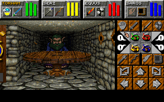
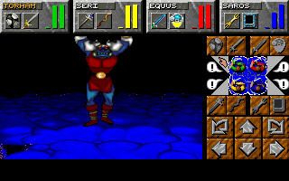

# DM2Mac: Dungeon Master II for macOS and Windows

DM2Mac is a native C11 and SDL3 port of **Dungeon Master II: The Legend of Skullkeep** (PC DOS, 1995) for macOS
and Windows. It is a recompilation: Ghidra decompiled the original DOS program to C, the game was rewritten in C11
with SDL3 from that code, and the result runs natively without DOSBox.

<p align="center">
  
  
</p>

## What you need

Your own copy of the PC DOS version of Dungeon Master II (English): its folder, its ZIP archive, or its CD image
(`.iso`, `.img`, `.bin`). This repository and the release contain no game files. Other versions (Amiga, FM Towns, other
languages) do not work.

## Play

1. Download the [latest release](https://github.com/peterkmet/dm2mac/releases/latest): `DM2Mac-macos-arm64.zip` or
   `DM2Mac-windows-x64.zip`. Extract it.
2. Copy your game (the folder, the ZIP archive, or the CD image) into the extracted `DM2Mac` folder.
3. Start the game:
   - **macOS:** In Terminal, remove the quarantine attribute in the `DM2Mac` folder:

     ```sh
     xattr -dr com.apple.quarantine DM2Mac.app
     ```

     Then double-click `DM2Mac.app` in the Finder.

   - **Windows:** Run `dm2.exe`. If SmartScreen warns about an unknown publisher, select "More info", then
     "Run anyway".

On first startup the game checks your files and copies the 10 files it needs into `game/` in the `DM2Mac` folder. If
a file is missing or wrong, a message names it. The game keeps all its files in `game/`: the game files, your saved
games in `game/DATA`, the settings, and the messages in `dm2.log`. To remove the game, delete the `DM2Mac` folder.

## Modes

On startup you choose how to play:

- **Vanilla**: the original game, unchanged.
- **Advanced** (the default): the original game with a few additions:
  - movement with the keyboard;
  - an automap of the squares you have seen;
  - quick save and quick load;
  - a cheat screen with six cheats and a list of all spells;
  - a pixel-art filter for the window, on the cheat screen.

In both modes the mouse and the arrow keys work as in the original game. The keys, the cheats, and the screen filter
are in the [advanced mode section of the Player manual](docs/manual.md#advanced-mode).

## For developers

DM2Mac is a C11 and SDL3 reimplementation of `SKULL.EXE`, built from its own Ghidra decompilation and checked
against the original in an emulator. Build instructions and tests are in [Development](docs/development.md); the documentation index is
[docs/README.md](docs/README.md). On macOS, a program such as an LLM can play the game turn by turn
([Control socket](docs/llm/control-socket.md), [Turn-based mode](docs/llm/turn-based.md)).

## Acknowledgements

- [SDL3](https://github.com/libsdl-org/SDL): windowing, input, and audio output.
- [Nuked-OPL3](https://github.com/nukeykt/Nuked-OPL3) by Nuke.YKT: OPL3 emulation for the music.
- [tinf](https://github.com/jibsen/tinf) by Jørgen Ibsen: ZIP decompression.
- [Unicorn](https://www.unicorn-engine.org): CPU emulation for the differential tests.
- [reDM2](https://codeberg.org/CyCl0ne/reDM2): an analysis of the same `SKULL.EXE`, read for names, formats, and
  logic.

## License

GPL-3.0-or-later ([LICENSE](LICENSE)). Nuked-OPL3 in `src/third_party/opl3/` is under the LGPL-2.1-or-later license
([opl3-LICENSE](src/third_party/opl3/opl3-LICENSE)); tinf in `src/third_party/tinf/` is under the zlib license
([tinf-LICENSE](src/third_party/tinf/tinf-LICENSE)). Dungeon Master II is the property of its rights holders. This
project is not affiliated with or endorsed by them. The game data is not included and is not covered by this license.
